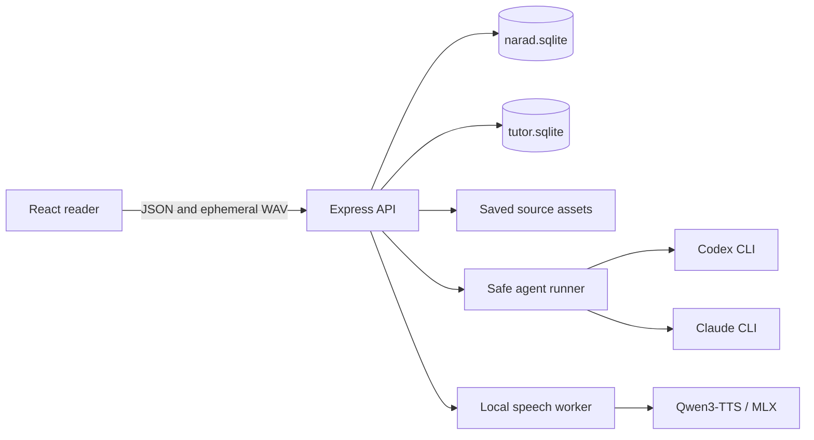
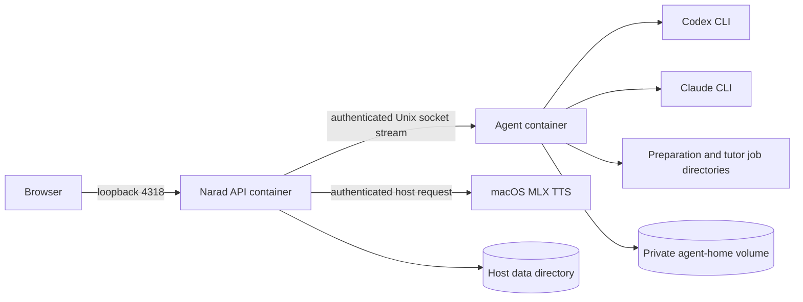

# Narad architecture

Narad is a local single-user learning system. A React reader talks to one loopback Express process; SQLite and saved image assets remain on the host. Codex or Claude prepares lessons and answers contextual questions. Qwen3-TTS runs as a long-lived local Python worker and returns short-lived WAV responses that are never saved.

## Main flow

## Content boundary

`shared/lesson.ts` is the saved lesson contract. A lesson contains sources, local assets, modes, sections, and stable blocks. Display Markdown/math and natural `spokenText` are stored together. Source-derived blocks carry references; teaching additions carry provenance.

Source capture and preparation use `server/store.ts`, `server/intake.ts`, `server/preparation.ts`, and `server/agent-runner.ts`. The preparation service owns at most one active authoring/review job and retains drafts under `data/preparation/`.

## Contextual tutor

`shared/tutor.ts` defines a closed answer grammar: text, equations, saved figures, node-edge diagrams, and numeric plots. The server validates every agent answer and the React app renders those structures itself. Raw agent HTML, JavaScript, and SVG never enter the DOM.

`server/tutor-context.ts` selects the active passage, its neighbors, referenced source text, figure metadata, lesson familiarity, and prior turns. `server/tutor.ts` saves the question first, reports coarse stages, runs the selected CLI with web access disabled for lesson-only answers or enabled for researched answers, and persists the validated result through `server/tutor-store.ts`.

Tutor messages use a separate `data/tutor.sqlite`. This isolates discussion persistence and cancellation from lesson preparation while keeping both under the same API lifecycle. Threads are keyed by lesson, mode, section, and block.

## Speech and playback

`server/speech.ts` serializes inference through one worker and validates WAV output. Lesson speech is addressed by lesson/mode/block/chunk. Tutor speech is addressed by saved turn/question-or-answer/chunk, so the browser cannot submit arbitrary text to the speech engine.

`src/lib/narration.ts` owns lesson audio, look-ahead, pause position, rate, and cancellation. Expanded reply threads are inserted into its item list; collapsed replies are absent. A live tutor answer uses a coordinated secondary player while the lesson player remains paused, allowing `Continue lesson` to resume the exact in-memory audio position.

## Trust and access

The API binds to `127.0.0.1`. `server/request-access.ts` checks Host, Origin, and fetch-site headers; an exact `NARAD_WEB_ORIGIN` permits a private HTTPS reverse proxy such as Tailscale Serve. Remote source downloads reject private network destinations and enforce byte, redirect, and concurrency limits.

Agent CLIs run in restricted, non-persistent sessions with bounded output and owned process groups. Lesson source text and learner questions are explicitly treated as untrusted data. Provider availability means the executable exists; the user still signs in through its normal CLI.

### Container boundary

The optional `compose.yaml` deployment keeps the API and agent in separate Linux containers and separate Docker networks. The API communicates with the agent over an authenticated HTTP/NDJSON event stream carried by a shared Unix-domain socket; cancellation closes that stream and aborts the owned CLI process group. The agent service has no TCP listener or published port.

The agent sees the job directories needed by the existing `AgentRunner` contract (the library folders, whose `<item>/preparation/calls/` directories hold each preparation's calls and copied images; legacy `data/preparations`; and `data/tutor`), the control socket, and its container-owned home directory. It streams session, token-usage and result events back to the API. It does not see the SQLite databases, general host filesystem, Docker control socket, or the API service network, and it is not given the TTS URL or token. Its root filesystem is read-only and its Linux capabilities are dropped. These operating-system controls reinforce the CLI-level tool restrictions; neither boundary is treated as a substitute for prompt validation and structured-output validation.

MLX remains a macOS host process because Docker Desktop Linux guests cannot use Metal. `server/tts-host.ts` wraps the existing resident worker behind a bearer-authenticated loopback/LAN endpoint, and the API container uses `RemoteSpeechWorker` through `host.docker.internal`. Audio remains transient and is never added to a volume.

## Persistent and ephemeral data

| Data | Location | Lifetime |
| --- | --- | --- |
| Lessons, settings, progress, captured assets | `data/narad.sqlite` | Persistent |
| Tutor turns | `data/tutor.sqlite` | Persistent |
| Preparation drafts and agent logs | `data/preparation/` | Persistent until removed with their source collection |
| Tutor agent prompts/results/logs | `data/tutor/<turn-id>/` | Persistent for diagnosis |
| TTS model | `data/models/qwen3-tts/` | Persistent installation |
| Generated WAV chunks | Browser memory / HTTP response | Released after playback, navigation, or cancellation |

`NARAD_DATA_DIR` relocates application data. Back up SQLite databases only after stopping Narad, or use SQLite backup tooling against a running process.
