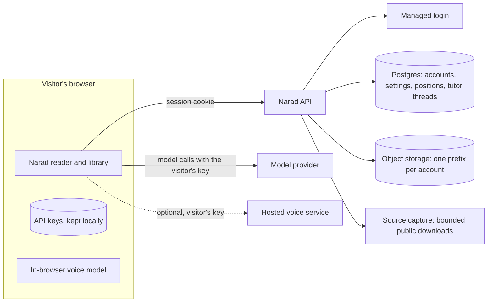

# Publishing Narad as a public website

A plan for taking Narad from a single-user app on one Mac to a free public website, written on 2026-11-24. Nothing in this plan is built yet. The local app stays as it is and remains the fullest edition.

## What the website is

- **Free to use.** No subscriptions and no payments.
- **Visitors bring their own model access.** A visitor pastes an API key for a model provider. The key stays in their browser.
- **Voice runs in the visitor's browser** by default, at no cost to anyone. A visitor may instead add their own key for a hosted voice service.
- **Each visitor has a private library** behind a login, with a storage limit.
- **The same lessons and reader as the local app**: quick summary, walkthrough, tutor dialogue, Course, presentation mode and the contextual tutor.

## Two editions from one codebase

| | Local app (today) | Website |
| --- | --- | --- |
| Who uses it | One person on their Mac | Anyone with an account |
| Lesson writing | Claude or Codex subscription through the installed CLI | The visitor's own API key, called from their browser |
| Voice | Breeze TTS 2 or Qwen3-TTS on the Mac | A small model in the browser, or the visitor's own voice API key |
| Storage | Folders under `data/library/` | Per-account space in object storage, with a quota |
| Cost to run | None | Hosting, database and storage only |

## Constraints that shape the design

These were checked on 2026-11-24. Re-check each before building on it.

1. **Subscriptions cannot be used through a website.** Anthropic's Claude Code documentation says Free, Pro and Max logins may not be used in any other product or service, and third parties may not route requests through them. OpenAI's "Sign in with ChatGPT" for third-party apps is a limited trial for selected partners. So the website takes API keys only; "bring your subscription" means the local app.
2. **The most expressive voice models are not licensed for a public service.** Breeze TTS 2 and Fish Audio Drama 3 are restricted to personal and research use, including the audio they produce. The website must use a permissively licensed voice (Kokoro is Apache 2.0, Qwen3-TTS is Apache 2.0, Chatterbox is MIT).
3. **A shared free voice API will not hold up.** Free tiers are limited per account, and every visitor would draw on the site's one account.
4. **Narad stores copies of other people's articles and images.** Libraries must stay private to their owner, and the site needs a takedown process.
5. **Lesson writing is expensive.** A test run spent $1.38 on part of a two-section article with a top-tier model. This is the visitor's cost, so the site must show an estimate before a run and the spend during it.

## Architecture

The server never sees a model key and never pays for a model call. It does four things: checks who is signed in, stores each account's files, captures source articles, and runs the deterministic parts of preparation (planning, checks, compiling the lesson).

### The browser as the agent runner

Today `PreparationService` asks an `AgentRunner` to run each call, then validates and saves the result. On the website the server keeps doing everything except the model call itself:

1. The server builds the next prompt and its output schema, as it does now.
2. It hands them to the visitor's browser over the existing progress stream.
3. The browser calls the model provider with the visitor's key and posts the answer back.
4. The server validates, runs the section checks, saves the section, and issues the next call.

This keeps prompts, fidelity checks and lesson compilation in one place for both editions. The costs are that the tab must stay open during preparation, and that a visitor could post back a made-up answer. The second only affects their own library, and the server still validates structure. Narad already saves each finished section, so closing the tab loses at most the call in flight.

## Where the code changes

| Area | Today | Change | Main files |
| --- | --- | --- | --- |
| Identity | None; loopback only | Every request carries an account; every read and write is scoped to it | `server/app.ts`, `server/request-access.ts` |
| Library files | `LibraryFs` over local folders | A second `LibraryFs` over object storage, one prefix per account | `server/library.ts`, `server/store.ts` |
| App state | SQLite files | Postgres tables keyed by account | `server/store.ts`, `server/tutor-store.ts` |
| Agent calls | CLI runner or the agent container | A browser-relay `AgentRunner` | `server/agent-runner.ts`, `server/runner.ts`, new client module |
| Preparation queue | In memory, one process | Per-account runs with state in the database | `server/preparation.ts` |
| Voice | MLX worker on the Mac | A browser renderer behind the existing `render` function | `src/hooks/useNarration.ts`, `src/lib/narration.ts` |
| Tutor | CLI call per question | The same browser relay | `server/tutor.ts` |
| Settings | One global record | Per account, plus site-wide limits the visitor cannot raise | `shared/settings.ts` |
| Source capture | One request at a time | Per-account rate limits and a shared worker pool | `server/capture.ts`, `server/download.ts` |

`NarrationController` already takes a "render this chunk" function, and `PreparationService` already takes an `AgentRunner`, so the voice and agent changes are new implementations of existing interfaces.

## Phases

Each phase ends with something that can be checked.

### Phase 0: Decisions and checks (days)

- Confirm that the model providers to be supported allow calls straight from a browser with the visitor's key, and note the opt-in each one needs.
- Pick the hosting: one small container for the API (the existing `Dockerfile` is the starting point), a managed Postgres, and S3-compatible object storage.
- Pick the managed login service. Email link plus one social login is enough.
- Choose the domain and confirm the name "Narad" is free to use publicly.
- Decide the per-account storage quota and the source limits (links, images, article size).
- **Done when:** these choices are written into this file.

### Phase 1: Accounts on every read and write

- Add an owner to every store method and route, with tests that one account cannot read, list, change or delete another's lessons, sources, media, positions, tutor threads or settings.
- Move settings, positions and tutor threads to Postgres. Keep SQLite for the local edition behind the same interface.
- Write the object-storage `LibraryFs`, with the same folder layout under `accounts/<id>/library/<slug>/`.
- Enforce the quota when saving sources and publishing a lesson.
- **Done when:** the full test suite passes in both local and hosted configurations, and the isolation tests pass.

### Phase 2: Login

- Add the managed login, session cookies, sign-out and account deletion (which removes the account's files and rows).
- Replace the loopback-only origin check with normal web session protection: secure cookies, request-forgery protection, and a strict content security policy.
- **Done when:** two test accounts can use the site at once and neither sees the other's data.

### Phase 3: Lesson writing with the visitor's key

- Build the browser-relay `AgentRunner` and its client module, including images, structured output, cancellation and the retry rules in `server/runner.ts`.
- Add a key screen: where the key is kept (this browser only), how to remove it, and a link to create one. Never send it to the Narad server and never log it.
- Show a cost estimate before a run, and tokens and cost during it. Narad already records usage per call.
- Choose default models per step: a strong model for section writing, a cheaper one for review and summary.
- Replace topic research (web search through the CLI) with the provider's web search tool, or require links on the website at first.
- **Done when:** a visitor can prepare a lesson from two links end to end with their own key, stop it, close the tab, and continue it later.

### Phase 4: Voice in the browser

- Add a browser renderer using Kokoro on WebGPU, running in a worker, with the browser's built-in speech as the fallback where WebGPU is missing.
- Map Narad's narrator, host and tutor to three distinct browser voices.
- Add the optional "use my own voice key" renderer for one hosted voice service.
- Measure on a mid-range phone and laptop: time to first audio, and whether the look-ahead buffer keeps up at 1.5× speed.
- **Done when:** a lesson can be listened to start to finish on a phone with no server-side speech.

### Phase 5: Source capture for many users

- Keep the existing protections (public addresses only, redirect checks, size and count limits) and add per-account rate limits and a daily cap.
- Respect `robots.txt` for capture, and identify the fetcher with a generic client name.
- Run capture in a small worker pool so one long article does not block other visitors.
- **Done when:** a load test with many simultaneous captures stays within memory and time limits.

### Phase 6: Legal, privacy and abuse

- Publish terms of use, a privacy policy and a takedown contact. Say plainly what is stored (captured articles, images, lessons, questions) and what is not (keys, audio).
- Keep libraries private. Do not add public sharing links until there is a takedown process that works.
- Add account-level limits and a way to suspend an account.
- Review prompt handling: source text and visitor questions are already treated as untrusted data in `server/prompt-security.ts`; confirm that holds when the browser relays calls.
- **Done when:** someone outside the project has read the terms and privacy pages and can say what the site stores about them.

### Phase 7: Deploy and operate

- Continuous deployment from the main branch, with the test suite as the gate.
- Daily database backups and object-storage versioning; practise one restore.
- Error reporting and basic metrics: sign-ups, lessons prepared, storage used, capture failures.
- A status note in the app when the site is in read-only maintenance.
- **Done when:** a restore from backup has been done once, and a deploy can be rolled back in one step.

### Phase 8: Private beta, then public

- Invite a handful of people, watch where they stop, and fix the first-run path: sign in, add a key, add a link, wait, read, listen.
- Write a short getting-started page and an honest limits page.
- Open sign-ups once a week has passed without a data or cost surprise.

## Running costs

With model calls and voice in the browser, the site pays for one small server, the database, stored files and outgoing data. Stored files grow with captured images, so the quota is the main cost control. Get current prices from the chosen providers before committing; none are quoted here.

## Risks

- **Browser model calls may be restricted by a provider.** Fallback: a server relay that forwards the visitor's key per request and stores nothing, which adds server load and a trust question.
- **In-browser voice may be too slow on older phones.** Fallback: the browser's built-in speech.
- **A long preparation needs the tab open.** Mitigation: per-section saving already exists; add a clear "keep this tab open" state and a resume prompt.
- **Copyright complaints about captured articles.** Mitigation: private libraries, a takedown contact, and no public sharing at launch.
- **A leaked key in the browser.** Mitigation: a strict content security policy, no third-party scripts, and advice to use a spend-limited key.

## Not yet verified

- That each provider permits direct browser calls for this use, and under which opt-in.
- Kokoro's speed and quality in the browser on phones; no measurement has been made.
- Whether the name and domain are available.
- Current hosting, database and storage prices.

## Sources

- [Claude Code legal and compliance](https://code.claude.com/docs/en/legal-and-compliance)
- [OpenAI Sign in with ChatGPT terms](https://openai.com/policies/sign-in-with-chatgpt-terms/)
- [OpenAI Codex authentication](https://developers.openai.com/codex/auth)
- [kokoro-js](https://npmjs.com/package/kokoro-js)
- [Breeze TTS 2 licence discussion](https://huggingface.co/BreezeBlue/Breeze-TTS-2/discussions/8)
- [Fish Audio Drama 3 discussions](https://huggingface.co/fishaudio/drama-3/discussions)
